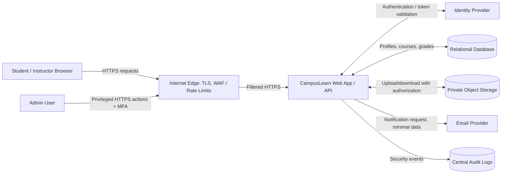

# Task 7 — Threat Model: CampusLearn Student Portal

**Assessment type:** Fictional application threat model  
**Status:** Initial design review  
**Method:** System decomposition + STRIDE-inspired threat identification  
**Scope:** Web sign-in, course pages, assignment upload/download, and administrative access

## 1. Executive summary

CampusLearn is a fictional portal used by students and instructors to view courses, submit assignments, and receive notifications. Its highest-priority risks are broken object-level authorization on submitted work, account compromise, and misuse of privileged accounts. The recommended first controls are server-side authorization checks on every record, strong sign-in protection, centralized security logging, and tightly controlled administrative access.

This model is based on the assumptions below. It is a design exercise, not an audit of a live application.

## 2. System description and assumptions

- Students and instructors use a browser over HTTPS.
- A web application serves the portal and calls an identity provider for authentication.
- Application data is stored in a relational database; uploaded assignment files are stored in private object storage.
- A managed email provider sends course and submission notifications.
- Administrators use a separate role in the same portal; privileged actions should be logged.
- The application does not intentionally expose one student's submissions to another student.
- The model assumes no direct public access to the database or object-storage bucket.

**Out of scope:** physical security, identity-provider internals, the email provider's internal controls, and vulnerabilities in third-party libraries. These remain dependencies that require separate review.

## 3. Assets and security objectives

| Asset | Security objective | Example impact if compromised |
|---|---|---|
| Student identity and profile data | Confidentiality, integrity | Privacy breach, account misuse |
| Assignment submissions and grades | Confidentiality, integrity, availability | Academic misconduct, altered grades, loss of work |
| Authentication sessions and recovery flows | Confidentiality, integrity | Account takeover |
| Instructor/admin privileges | Least privilege, accountability | Bulk data exposure or unauthorized changes |
| Audit and authentication logs | Integrity, availability | Investigations become unreliable or incomplete |
| Application secrets and service credentials | Confidentiality, rotation | Unauthorized database or storage access |

## 4. Data-flow diagram

### Trust boundaries

1. **TB1 — Public internet to edge:** requests are untrusted; apply TLS, request-size limits, WAF protections where appropriate, and rate limiting.
2. **TB2 — Edge to application/API:** validate input and enforce authentication/authorization in the application; do not rely on the edge alone.
3. **TB3 — Application to identity provider:** validate tokens, issuer, audience, expiry, and signature; protect client credentials.
4. **TB4 — Application to database/object storage:** use service identities, private access, least privilege, and per-object authorization.
5. **TB5 — Application to email provider/logging:** send only necessary data; protect integration credentials; prevent sensitive values from entering logs.
6. **TB6 — Student/instructor to administrative actions:** privileged operations need stronger authentication, explicit authorization, and tamper-resistant audit trails.

## 5. Prioritized threat register

Ratings are qualitative: **High** means the plausible impact and exposure justify early treatment; **Medium** means mitigation is needed but can follow higher risks. Ratings are preliminary because real likelihood depends on architecture, usage, and existing controls.

| ID | STRIDE category | Threat scenario | Likelihood | Impact | Priority | Mitigation and validation |
|---|---|---|---|---|---|---|
| T1 | Elevation of privilege / Information disclosure | A student changes a submission or grade identifier in a request and accesses another student's record (broken object-level authorization). | Medium | High | **High** | Check ownership/role on every server-side read and write; deny by default. Test student A cannot read, modify, or download student B's records by changing identifiers. |
| T2 | Spoofing | Repeated password guessing or password spraying leads to account takeover. | Medium | High | **High** | MFA/passkeys where feasible, rate limits, breached-password controls, risk-based lockout or challenges, and alerting on repeated failures. Validate the alert with the Task 9 synthetic test suite and review false positives. |
| T3 | Tampering | A user submits crafted input that changes records or exploits unsafe query construction. | Medium | High | **High** | Use parameterized queries, server-side validation, authorization checks, and safe output handling. Add negative tests for malformed input and unauthorized changes. |
| T4 | Information disclosure | Assignment files are stored in a public bucket or downloaded without per-file authorization. | Low–Medium | High | **High** | Keep storage private; issue short-lived scoped download links only after authorization; review bucket policy and test unauthenticated and cross-user download attempts. |
| T5 | Elevation of privilege | An instructor/admin account is compromised or has excessive permissions. | Medium | High | **High** | Enforce MFA, role separation, just-in-time/admin approval for sensitive operations, periodic access review, and immutable audit records. Test that each role can perform only its approved actions. |
| T6 | Information disclosure / Tampering | Application logs expose session tokens or personal data, or an attacker alters/deletes logs. | Medium | Medium–High | **Medium–High** | Redact secrets and unnecessary PII; restrict log access; forward security events to a separately controlled store; alert on logging gaps and privileged log changes. |
| T7 | Denial of service | Large or repeated uploads exhaust storage, bandwidth, or application workers. | Medium | Medium | **Medium** | Enforce upload size/type limits, quotas, throttling, timeouts, malware scanning where appropriate, and capacity alerts. Test size and rate limits. |
| T8 | Spoofing / Information disclosure | A misconfigured notification integration sends sensitive grades or tokens to the wrong recipient/provider endpoint. | Low–Medium | Medium | **Medium** | Minimize notification content, validate recipients, protect integration secrets, and audit outbound events. Use synthetic accounts to verify message content and destination handling. |
| T9 | Repudiation | A privileged change cannot be attributed because audit events lack actor, target, time, or outcome. | Medium | Medium | **Medium** | Record actor ID, action, target ID, timestamp, outcome, and correlation ID; protect logs from modification. Verify that a sample grade change generates a complete event. |

## 6. Recommended implementation order

1. **Before release:** fix authorization at the object/record level (T1); verify private file storage (T4); protect administrative accounts (T5).
2. **At release:** enable sign-in protections and tested failure alerts (T2); use safe query/input handling (T3); redact and protect logs (T6/T9).
3. **Operational hardening:** tune upload/rate limits (T7), minimize notification data (T8), and review the threat model after major design changes.

## 7. Residual risk and limitations

- A threshold alert does not prove malicious activity. Shared NAT addresses, users with mistyped passwords, and scripted legitimate clients may create benign bursts.
- A single-source-IP threshold may miss slow guessing spread across time or attempts distributed across many IPs. Correlate across user, IP, device, ASN/geo context, and success-after-failure patterns where reliable telemetry exists.
- Threats involving the identity provider, cloud storage provider, or email service need supplier/configuration evidence beyond this model.
- STRIDE is used as a structured prompt, not a claim that every possible threat has been found.

## 8. Review and validation checklist

- [ ] Confirm that the diagram reflects deployed components and actual data flows.
- [ ] Test authorization on reads, writes, downloads, and administrative actions.
- [ ] Verify storage privacy and service-identity permissions.
- [ ] Confirm authentication events contain consistent timestamps, source IPs, user identifiers, and outcomes.
- [ ] Run and tune the detection tests described in Task 9.
- [ ] Assign owners and due dates to accepted mitigations; revisit this model after material changes.

## 9. References

See [`../SOURCES.md`](../SOURCES.md), especially OWASP's Threat Modeling Cheat Sheet and MITRE ATT&CK T1110.
